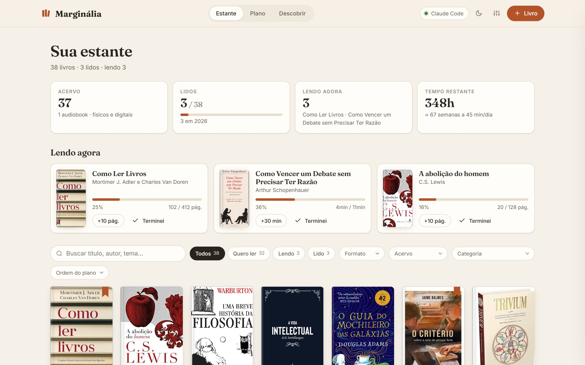
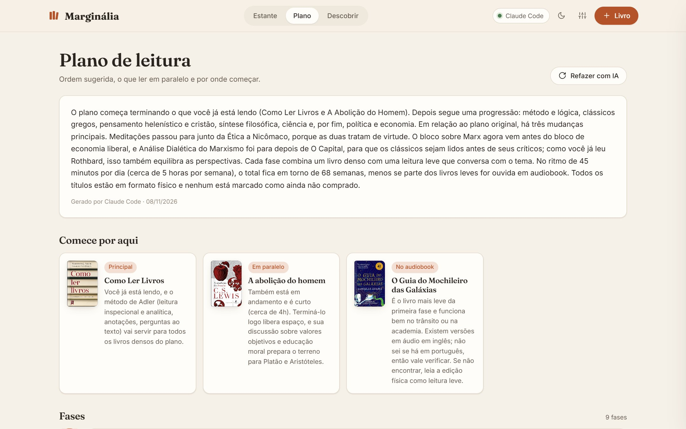
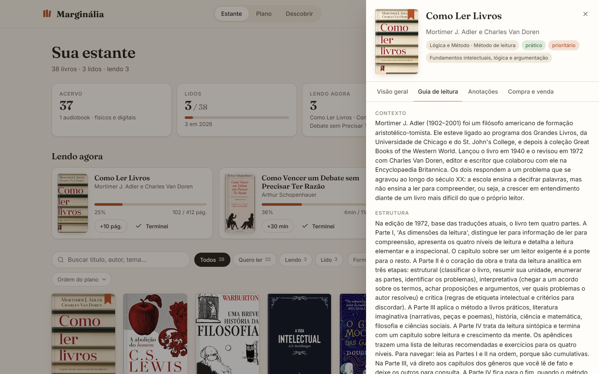
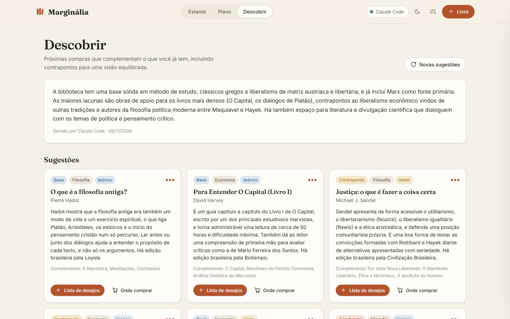
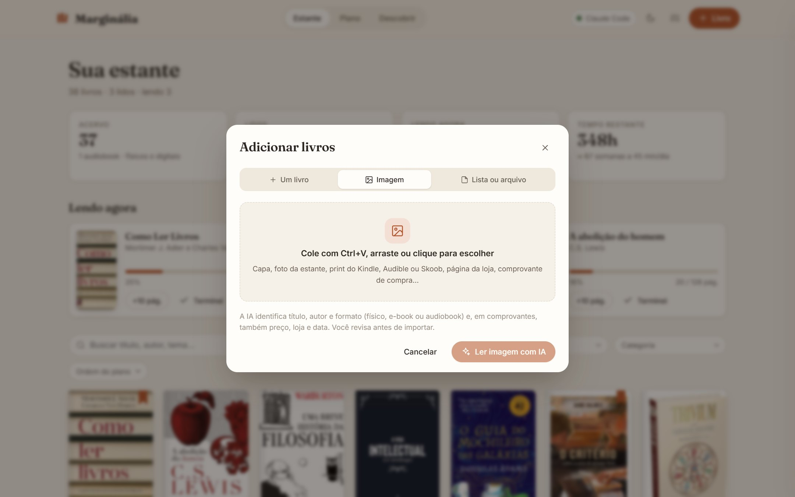
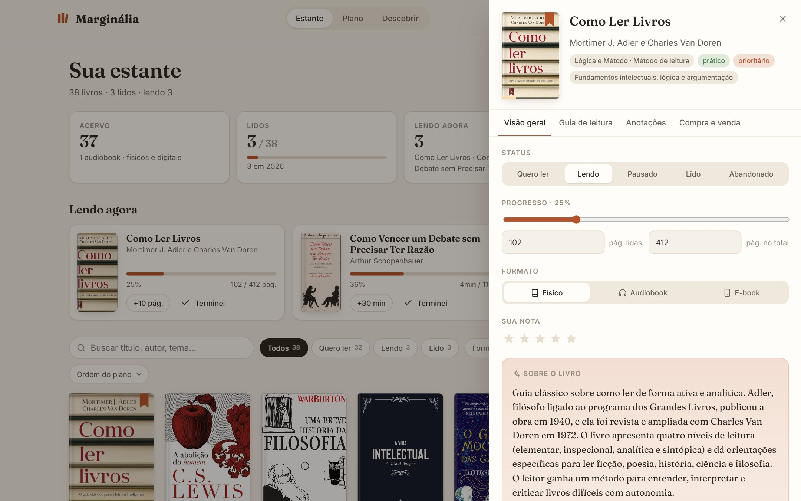
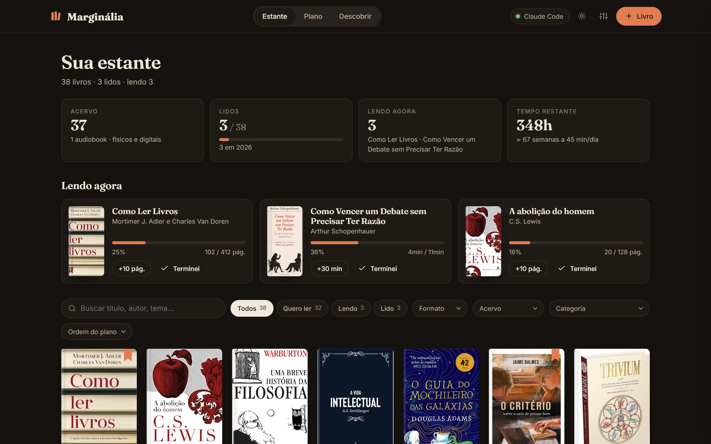
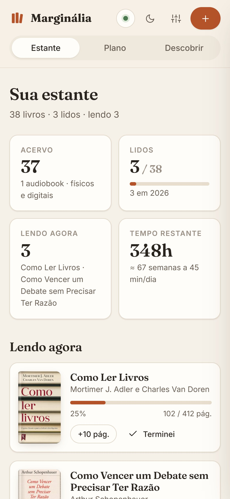
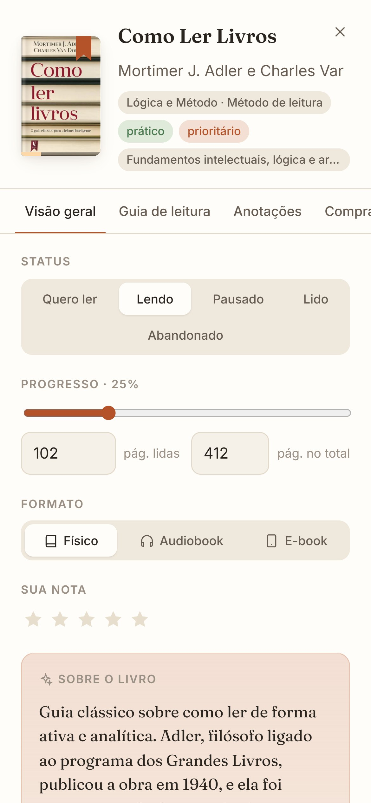
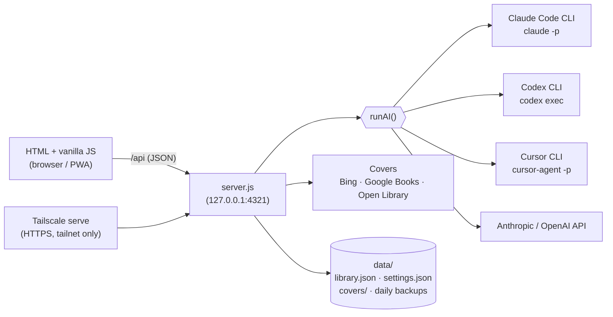

<div align="center">

# 📚 Marginália

**English** · [Português](README.pt-BR.md)

### Your personal library, a reading plan and an AI librarian: classify every book, know what to read next, what to read in parallel and what to buy.

**Claude · Codex (ChatGPT) · Cursor**: with the login you already have, or an API key.
Self-hosted: runs 100% on your computer. Your data never leaves it (it only goes to the AI you pick, at the moment of each task).

<br/>


<br/>



<sub>Demo library (<code>npm run demo</code>). The UI is in Brazilian Portuguese.</sub>

</div>

---

**Marginália** is a small, self-hosted **reading tracker** for physical books, e-books and audiobooks: what you own, bought, sold or lent, what you're reading and how far you are. An AI you already use (**Claude Code, OpenAI Codex or Cursor**, or an Anthropic/OpenAI API key) classifies each book, writes a short introduction, builds a **reading plan** with phases and parallel reads, writes **reading guides** and suggests **what to buy next**.

It's deliberately light: **one Node file, one HTML page, plain JavaScript, no build step, no database**. Your library lives in a JSON file.

## ✨ Features

| | |
|---|---|
| 🏷️ **Automatic classification** | Category and subcategory, nature (theoretical, practical, narrative or mixed), difficulty 1–5, pages, reading hours, a 2–4 sentence introduction, "why read it", themes, prerequisites and **which books on your shelf it talks to**. Missing authors get filled in. |
| 🗺️ **Reading plan** | Progressive phases with a goal and an estimate in weeks at *your* pace (minutes per day), **where to start** (main read, parallel read, audiobook), **pairs that work well in parallel** routine tips and **books worth rereading now**. If you import a plan you already had, the AI keeps what makes sense and explains what it changed. |
| 📖 **Reading guides** | For the book you're about to start: context, structure and how to navigate it, key ideas, tricky passages, questions to read actively, how to read it (pace, edition) and connections with the rest of your shelf. |
| 📚 **Reference reading lists** | Plans and suggestions follow the curated study lists of [Contra os Acadêmicos](https://contraosacademicos.com.br/lista) (62 lists, from "prolegomena" to advanced levels, plus their prerequisites between subjects). Each book shows where it sits in those lists. The Plan and Discover tabs have **two modes side by side**: *Contra os Acadêmicos* (follows the lists' order, levels and prerequisites, and fills the gaps they consider essential) and *AI view* (the AI's own judgment, based on the general assessment of each work). Each mode keeps its own plan and suggestions. The lists are downloaded once and refreshed every 30 days; turn it off in Settings. |
| 🧭 **Discover** | 8–10 books to buy, mixing **foundations** (to make dense books easier), **go deeper**, **counterpoints** (other traditions on the same themes, for a balanced view) and **leisure**. Each one says which of your books it complements; add it to your wishlist in one click. |
| 💬 **Just ask for a book** | Describe it however you like ("Harari's book on the history of humankind, bought the audiobook on Audible"). If it's ambiguous (same title by different authors, a vague description, a series) the AI **asks which one you mean**, with one-tap options, before adding. Format, status and purchase details come from what you wrote. |
| 📸 **Add books from a screenshot** | Paste (Ctrl+V), drop or pick up to 6 images: a cover, a photo of your shelf, a Kindle/Audible/Goodreads screenshot, a store page or **a purchase receipt** (price, store and date come along). On the phone it opens the camera. You review before importing. |
| 🖼️ **Covers, automatically** | Every book gets its cover from Bing Images, Google Books or Open Library, ranked by title/author/volume match and checked for a cover-like aspect ratio, then **cached locally**. Click a cover to pick another one, search, upload or paste your own. |
| 🎧 **Physical, e-book, audiobook** | Progress in pages or minutes, "+10 pages" / "+30 min" buttons, status (want to read, reading, paused, read, abandoned), ratings, structured notes (thesis, arguments, concepts, agree/disagree…) and **purchase, sale and loan** records. |
| 🔁 **Rereading** | Dense books rarely give everything on the first pass. **Read again** keeps every past reading (dates and rating) in the book's history; **Want to reread** puts it back into the next plan, placed where the second reading pays off, and its guide is rewritten for a reread. |
| 📥 **Import your list** | A markdown reading plan (phases, priorities, authors) or any free-form list; the AI can extract books from messy text too. |
| 📱 **On your phone (PWA)** | Installable on the home screen, with a mobile layout. Reach it from any device on your **Tailscale** network, with nothing exposed to the internet. |
| 🌓 **Light & dark** | Follows the system, with a toggle. |
| 💾 **Safe by default** | Atomic writes, a daily backup (last 7 days), conflict detection between tabs/devices, and JSON export/restore. |

<div align="center">






</div>

<div align="center">



</div>

---

## 🚀 Getting started

**Requirements:** Node.js 18.17+ and **one** of the AIs below.

### 🤖 Install with your AI (copy & paste)

Open **Claude Code**, **Codex** or the **Cursor** agent in an empty folder and paste:

```text
Install Marginália (https://github.com/isacsneto/marginalia) on this computer for me:
1. Check that Node.js 18.17+ and git are installed; if not, tell me how to install them on my OS and wait.
2. Clone the repository into a folder (default: ~/marginalia) and run "npm install".
3. Check whether an AI is ready: Claude Code ("claude auth status"), Codex ("codex login status") or Cursor ("cursor-agent status"). If none is logged in, ask which one I want and guide me through the login (I will run interactive logins myself).
4. On Windows, ask whether I want the app always running in the background. If yes, run "npm run local:install" and show me the address it prints; otherwise run "npm start".
5. If Tailscale is installed, check that the https://….ts.net:8443 address opens; if "tailscale serve" asks to enable HTTPS, show me the link.
6. Open http://localhost:4321 and tell me to import my book list or add books with "+ Livro".
Do not put API keys in commands or files (I enter those myself in the app's Settings). Do not expose the app to the internet: no port forwarding and no Tailscale Funnel.
```

### ⌨️ Or by hand

```bash
git clone https://github.com/isacsneto/marginalia.git
cd marginalia
npm install
npm start            # opens http://localhost:4321
```

On Windows you can also double-click `iniciar.bat`.

Want to look around first? The demo runs a sample library on port 4322 with separate data:

```bash
npm run demo         # npm run demo:reset recreates the sample library
```

On first run the empty shelf offers to import a list: a markdown file (sections become plan phases) or text pasted in **+ Livro → Lista ou arquivo**. The AI classifies everything right after.

### 🤖 Choose your AI

In **Settings** (the sliders icon at the top) pick a provider, or leave it on **Automatic**: the first available one in this order, Claude Code → Codex → Cursor Agent → Anthropic API → OpenAI API.

| Provider | 🔐 Local login (uses your subscription) | 🔑 API key |
|---|---|---|
| **Claude** (Anthropic) | [Claude Code](https://claude.com/claude-code) logged in (`claude`) | `ANTHROPIC_API_KEY` or Settings (default model `claude-opus-5-5`) |
| **Codex** (OpenAI / ChatGPT) | [Codex CLI](https://github.com/openai/codex) logged in (`codex`) | `OPENAI_API_KEY` or Settings (default model `gpt-5-mini`) |
| **Cursor** | [Cursor CLI](https://cursor.com/docs/cli/installation) logged in (`cursor-agent`) | — |

- CLIs must be on your `PATH`. They're called non-interactively, with no tools, from a temporary folder.
- Reading images works with Claude Code, Codex and both APIs (the Cursor CLI doesn't take images).
- Keys typed in Settings are stored only in `data/settings.json` (outside git) and **never sent back to the browser**.
- "Model for CLIs" is passed as `--model` (e.g. `sonnet`, `opus`).

### 🖥️ Keep it running in the background (Windows)

```bash
npm run local:install    # starts hidden on every login + Tailscale access
npm run local:stop       # stop now (comes back on next login)
npm run local:uninstall  # removes auto-start and tailscale serve
```

`local:install` creates a Task Scheduler task **"Marginalia"** that runs `server.js` as **your user** (so the AI uses the Claude/Codex login you already have) through `conhost --headless`: no window to close by accident. If the server crashes it comes back in seconds. Logs live in `data/logs/server.log`. With the task installed, `iniciar.bat` just opens the browser. No admin rights needed.

On macOS/Linux, run `npm start` (or your own service manager) and `tailscale serve --bg --https=8443 http://127.0.0.1:4321`.

### 📱 Access from your phone with Tailscale

[Tailscale](https://tailscale.com/download) creates a private network between your devices (free for personal use). The app keeps listening only on `127.0.0.1`; `tailscale serve` hands the address, with HTTPS, **only to devices signed in to your account**.

1. Install Tailscale on the computer running the app and sign in.
2. Run `npm run local:install`. It runs `tailscale serve --bg --https=8443 http://127.0.0.1:4321` and prints the address, like `https://my-pc.tail1234.ts.net:8443`.
   - Port 8443 avoids clashing with another app on 443. Set `TS_PORT` before installing to change it.
   - The first time, Tailscale may ask you to **enable HTTPS on your tailnet**: open the link it prints, confirm and run the command again.
3. On your phone, install the **Tailscale** app ([iPhone](https://apps.apple.com/app/tailscale/id1470499037) · [Android](https://play.google.com/store/apps/details?id=com.tailscale.ipn)), sign in with the **same account** and keep the VPN on.
4. Open the `https://….ts.net:8443` address.

**Install it on your home screen:** iPhone (Safari) → **Share** → **Add to Home Screen**. Android (Chrome) → **⋮** → **Install app**.

> 🔒 **Don't expose the app to the internet** (router port forwarding, Tailscale Funnel, public tunnels): it has no login screen, and anyone who reaches it can read and edit your library. `tailscale serve` is different from Funnel: only your tailnet can see it.

---

## 🧩 How it works



- **One prompt per task, JSON out.** Classify, plan, suggest, guide and read images each have a prompt (`lib/prompts.js`) that asks for a single JSON object; the answer is parsed, validated and sanitized before it touches your library.
- **Batches in parallel.** Classification runs 6 books per call, 2 calls at a time, with progress on screen.
- **Covers are verified, not guessed.** Candidates are scored by title-word match, author, trusted hosts and volume number; the image's real dimensions must look like a book cover (or a square audiobook cover) before it's saved.

---

## 🔒 Privacy & security

- The server listens **only on `127.0.0.1`**. Requests must come from the app itself: the `Host` must be localhost or this machine's own Tailscale name, the `Origin` must match it, and writes must be JSON. This blocks DNS rebinding and other websites calling the API.
- Everything lives in `data/` (outside git): library, settings, API keys and covers.
- Images you import go to the chosen AI at analysis time and aren't stored.
- Cover search sends only the book title and author to the image sources.

---

## 🛠️ Development

```bash
npm test             # node:test (importer, JSON parsing, image dimensions)
npm run demo         # sample data on port 4322 (DATA_DIR=demo-data)
```

```
server.js          HTTP server + JSON API (127.0.0.1:4321), host/origin checks, atomic writes, backups
lib/ai.js          provider detection and execution (CLIs and APIs, with images)
lib/prompts.js     one prompt per AI task
lib/importer.js    markdown/plain-text list parser
lib/covers.js      cover search, ranking, validation and local cache
public/            UI (index.html, app.js, styles.css), PWA manifest and icons
scripts/           demo, Windows background service (windows/), sample library (demo/)
test/              tests
```

Environment variables: `PORT` (default 4321), `DATA_DIR` (another data folder), `NO_OPEN=1` (don't open the browser), `TRUSTED_HOSTS` (extra host names to accept, comma-separated), `ANTHROPIC_API_KEY`, `OPENAI_API_KEY`.

Ideas for later: [a native desktop build with Rust/Tauri](docs/plano-desktop-tauri.md) (in Portuguese).

---

## 📄 License

[MIT](LICENSE) © 2026 Isac Santos. Use, modify and share freely, keeping the copyright notice. The software is provided "as is", without warranty.

Book covers are fetched at runtime from third-party sources and belong to their publishers; they're stored only on your computer.

---

<sub>
⚠️ Introductions, plans, guides and suggestions are AI-generated and may contain mistakes. Check before buying.
</sub>
