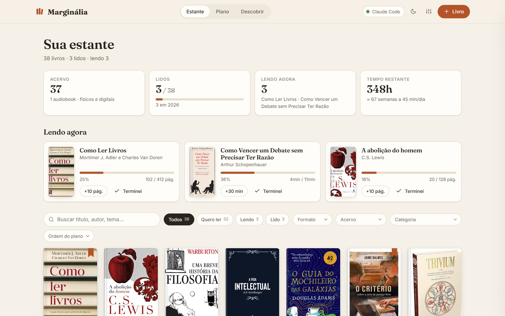
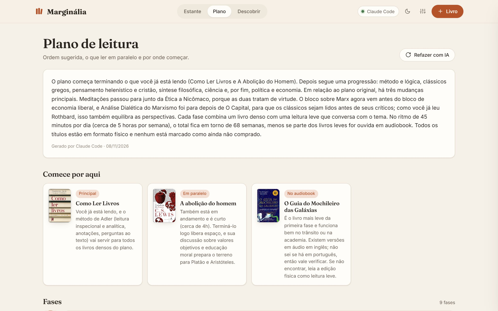
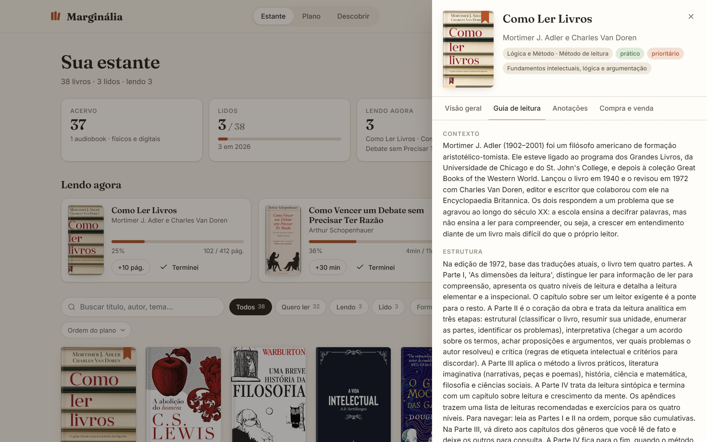
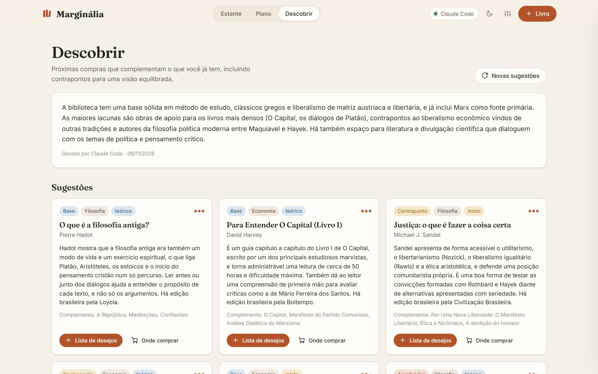
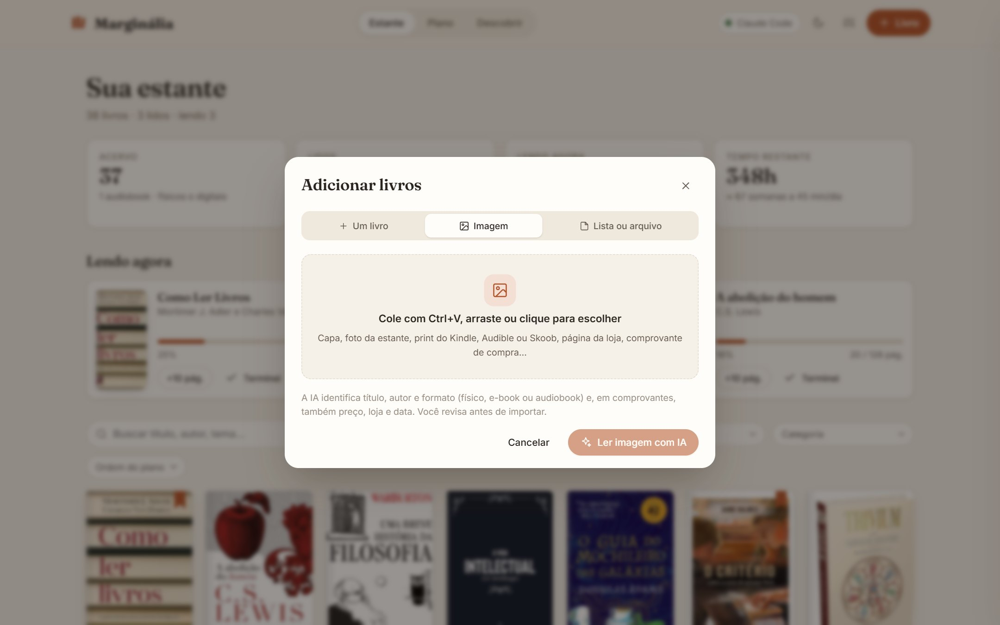
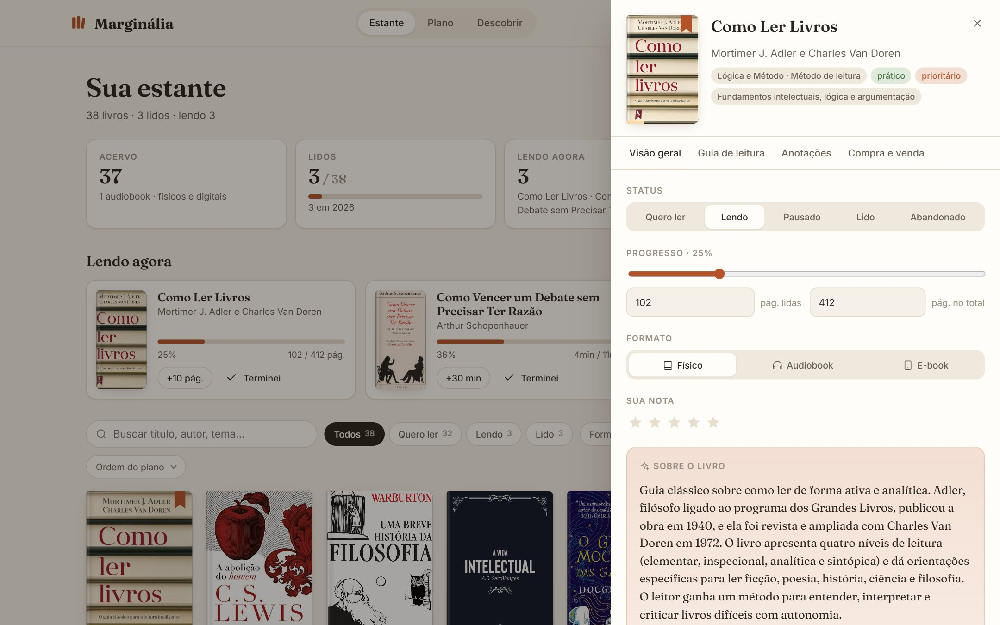
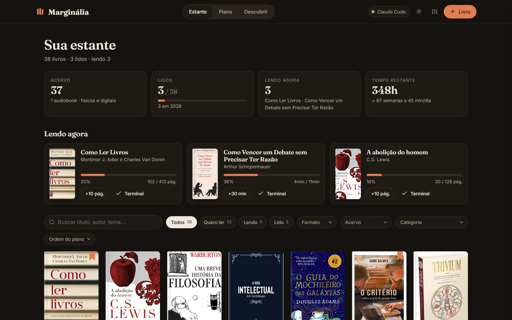
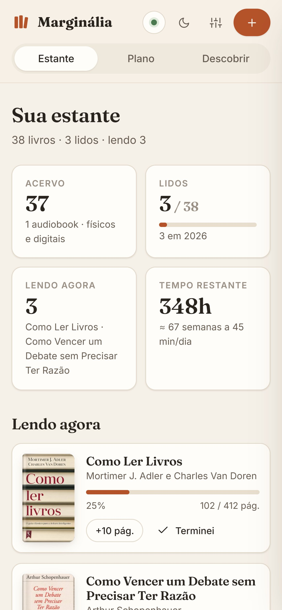
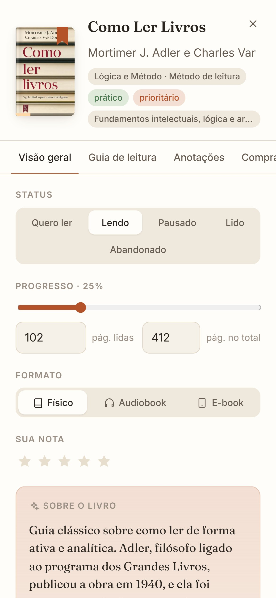
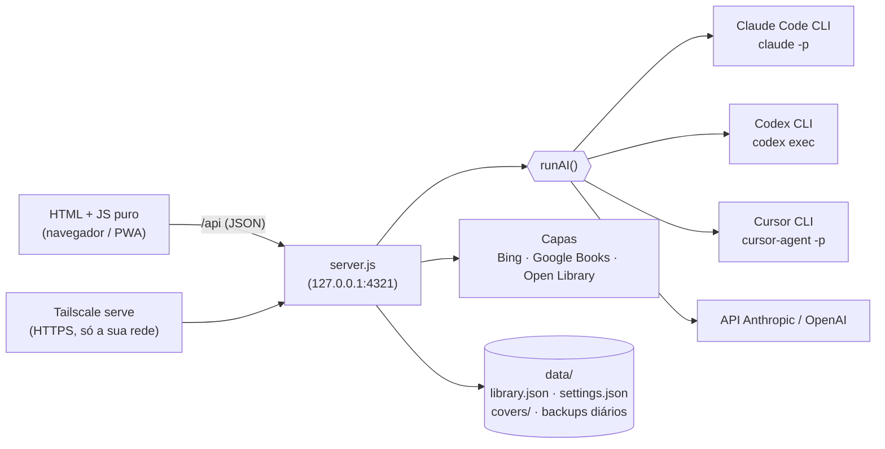

<div align="center">

# 📚 Marginália

[English](README.md) · **Português**

### Sua biblioteca pessoal, um plano de leitura e um bibliotecário com IA: classifica cada livro, diz o que ler agora, o que ler em paralelo e o que comprar depois.

**Claude · Codex (ChatGPT) · Cursor**: com o login que você já tem, ou com API key.
Self-hosted: roda 100% no seu computador. Seus dados não saem dele (só vão para a IA escolhida, no momento de cada tarefa).

<br/>


<br/>



<sub>Estante de exemplo (<code>npm run demo</code>).</sub>

</div>

---

O **Marginália** é um app leve e self-hosted para **acompanhar sua leitura**: livros físicos, e-books e audiobooks, o que você tem, comprou, vendeu ou emprestou, o que está lendo e em que ponto. Uma IA que você já usa (**Claude Code, OpenAI Codex ou Cursor**, ou uma API key da Anthropic/OpenAI) classifica cada livro, escreve uma introdução curta, monta um **plano de leitura** com fases e leituras em paralelo, escreve **guias de leitura** e sugere **o que comprar depois**.

É simples de propósito: **um arquivo Node, uma página HTML, JavaScript puro, sem build e sem banco de dados**. Sua biblioteca fica num arquivo JSON.

## ✨ Recursos

| | |
|---|---|
| 🏷️ **Classificação automática** | Categoria e subcategoria, natureza (teórico, prático, narrativo ou misto), dificuldade de 1 a 5, páginas, horas de leitura, introdução de 2 a 4 frases, "por que ler", temas, pré-requisitos e **quais livros da sua estante dialogam com ele**. Autores faltando são completados. |
| 🗺️ **Plano de leitura** | Fases progressivas com objetivo e estimativa de semanas no *seu* ritmo (minutos por dia), **por onde começar** (principal, paralelo e audiobook), **pares que funcionam bem em paralelo** dicas de rotina e **livros que valem uma releitura agora**. Se você importar um plano que já tinha, a IA aproveita o que faz sentido e explica o que mudou. |
| 📖 **Guias de leitura** | Para o livro que você vai começar: contexto, estrutura e como navegar, ideias centrais, passagens difíceis, perguntas para ler ativamente, como ler (ritmo, edição) e conexões com o resto da estante. |
| 📚 **Listas de referência** | Dois modos lado a lado no Plano e no Descobrir. **Contra os Acadêmicos** segue exatamente o programa de estudos do [Contra os Acadêmicos](https://contraosacademicos.com.br/lista/o-ordenamento-das-leituras/): o plano é montado direto das listas do site (sem IA), com os Prolegômenos primeiro, a Filosofia nível a nível na ordem numerada do site, as listas de área liberadas como pede o Projeto do Polímata e a literatura em paralelo. Mostra onde entra cada livro seu e **o que falta em cada etapa** (um clique leva para a lista de desejos), e o Descobrir sugere o que falta na etapa atual. **Visão da IA** é o critério próprio da IA, com base na avaliação geral de cada obra. Cada livro também mostra onde aparece nas listas. As listas vêm da API pública do site, ficam em cache e são renovadas a cada 30 dias; dá para desligar nos Ajustes. |
| 🧭 **Descobrir** | 8 a 10 livros para comprar, misturando **base** (para facilitar os livros densos), **aprofundar**, **contraponto** (outras tradições sobre os mesmos temas, para uma visão equilibrada) e **lazer**. Cada um diz quais livros seus complementa; vai para a lista de desejos com um clique. |
| 💬 **Peça um livro à IA** | Descreva do seu jeito ("o do Harari sobre a história da humanidade, comprei o audiobook na Audible"). Se houver dúvida (mesmo título de autores diferentes, descrição vaga, volumes de uma série), a IA **pergunta qual é**, com opções de um toque, antes de adicionar. Formato, status e dados de compra saem do que você escreveu. |
| 📸 **Adicionar por screenshot** | Cole (Ctrl+V), arraste ou escolha até 6 imagens: capa, foto da estante, print do Kindle, Audible ou Skoob, página de loja ou **comprovante de compra** (preço, loja e data vêm junto). No celular, abre a câmera. Você revisa antes de importar. |
| 🖼️ **Capas automáticas** | Cada livro ganha a capa do Bing Imagens, Google Books ou Open Library, escolhida pela correspondência de título, autor e volume, conferida pela proporção de capa e **salva localmente**. Clique na capa para escolher outra, buscar, enviar ou colar a sua. |
| 🎧 **Físico, e-book, audiobook** | Progresso em páginas ou minutos, botões "+10 pág." e "+30 min", status (quero ler, lendo, pausado, lido, abandonado), nota, anotações estruturadas (tese, argumentos, conceitos, concordo/discordo…) e registro de **compra, venda e empréstimo**. |
| 🔁 **Releitura** | Livros densos raramente se esgotam numa leitura. **Ler de novo** guarda cada leitura anterior (datas e nota) no histórico do livro; **Quero reler** devolve o livro ao próximo plano, no ponto em que a releitura rende mais, e o guia é refeito pensando na releitura. |
| 📥 **Importe sua lista** | Um plano de leitura em markdown (fases, prioridades, autores) ou qualquer lista em texto livre; a IA também extrai livros de texto bagunçado. |
| 📱 **No celular (PWA)** | Instalável na tela inicial, com layout para celular. Acesse de qualquer aparelho da sua rede **Tailscale**, sem expor nada na internet. |
| 🌓 **Claro e escuro** | Segue o sistema, com botão para alternar. |
| 💾 **Seguro por padrão** | Gravação atômica, backup diário (últimos 7 dias), detecção de conflito entre abas e aparelhos, e exportar/restaurar em JSON. |

<div align="center">






</div>

<div align="center">



</div>

---

## 🚀 Como começar

**Requisitos:** Node.js 18.17+ e **uma** das IAs abaixo.

### 🤖 Instale com a sua IA (copie e cole)

Abra o **Claude Code**, o **Codex** ou o agente do **Cursor** numa pasta vazia e cole:

```text
Instale o Marginália (https://github.com/isacsneto/marginalia) neste computador para mim:
1. Confira se o Node.js 18.17+ e o git estão instalados; se não, me diga como instalar no meu sistema e espere.
2. Clone o repositório numa pasta (padrão: ~/marginalia) e rode "npm install".
3. Veja se alguma IA está pronta: Claude Code ("claude auth status"), Codex ("codex login status") ou Cursor ("cursor-agent status"). Se nenhuma estiver logada, pergunte qual eu quero e me guie no login (logins interativos eu mesmo faço).
4. No Windows, pergunte se quero o app sempre rodando em segundo plano. Se sim, rode "npm run local:install" e me mostre o endereço que ele imprimir; se não, rode "npm start".
5. Se o Tailscale estiver instalado, confira se o endereço https://….ts.net:8443 abre; se o "tailscale serve" pedir para habilitar HTTPS, me mostre o link.
6. Abra http://localhost:4321 e me diga para importar minha lista de livros ou adicionar livros em "+ Livro".
Não coloque API keys em comandos ou arquivos (eu cadastro na tela de Ajustes do app). Não exponha o app na internet: nada de redirecionar portas nem usar Tailscale Funnel.
```

### ⌨️ Ou na mão

```bash
git clone https://github.com/isacsneto/marginalia.git
cd marginalia
npm install
npm start            # abre http://localhost:4321
```

No Windows também dá para dar dois cliques em `iniciar.bat`.

Quer conhecer antes? O demo abre uma estante de exemplo na porta 4322, com dados separados:

```bash
npm run demo         # npm run demo:reset recria a estante de exemplo
```

Na primeira vez, a estante vazia oferece importar uma lista: um arquivo markdown (as seções viram fases do plano) ou um texto colado em **+ Livro → Lista ou arquivo**. A IA classifica tudo em seguida.

### 🤖 Escolha a IA

Em **Ajustes** (ícone de controles no topo), escolha o provedor ou deixe em **Automático**: usa o primeiro disponível nesta ordem, Claude Code → Codex → Cursor Agent → API Anthropic → API OpenAI.

| Provedor | 🔐 Login local (usa sua assinatura) | 🔑 API key |
|---|---|---|
| **Claude** (Anthropic) | [Claude Code](https://claude.com/claude-code) logado (`claude`) | `ANTHROPIC_API_KEY` ou Ajustes (modelo padrão `claude-opus-5-5`) |
| **Codex** (OpenAI / ChatGPT) | [Codex CLI](https://github.com/openai/codex) logado (`codex`) | `OPENAI_API_KEY` ou Ajustes (modelo padrão `gpt-5-mini`) |
| **Cursor** | [Cursor CLI](https://cursor.com/docs/cli/installation) logado (`cursor-agent`) | — |

- Os CLIs precisam estar no `PATH`. O app os chama em modo não interativo, sem ferramentas, numa pasta temporária.
- A leitura de imagens funciona com Claude Code, Codex e as duas APIs (o CLI do Cursor não recebe imagens).
- Chaves digitadas em Ajustes ficam só em `data/settings.json` (fora do git) e **nunca voltam para o navegador**.
- O campo "Modelo para CLIs" é repassado como `--model` (ex.: `sonnet`, `opus`).

### 🖥️ Deixar rodando em segundo plano (Windows)

```bash
npm run local:install    # sobe oculto a cada login + acesso pelo Tailscale
npm run local:stop       # para agora (volta no próximo login)
npm run local:uninstall  # remove a inicialização automática e o tailscale serve
```

O `local:install` cria a tarefa **"Marginalia"** no Agendador de Tarefas. Ela roda o `server.js` como **o seu usuário** (assim a IA usa o login do Claude/Codex que você já tem) via `conhost --headless`: nenhuma janela para fechar sem querer. Se o servidor cair, volta em segundos. O log fica em `data/logs/server.log`. Com a tarefa instalada, o `iniciar.bat` só abre o navegador. Não precisa de administrador.

No macOS/Linux, rode `npm start` (ou o seu gerenciador de serviços) e `tailscale serve --bg --https=8443 http://127.0.0.1:4321`.

### 📱 Acessar pelo celular com o Tailscale

O [Tailscale](https://tailscale.com/download) cria uma rede privada entre os seus aparelhos (grátis para uso pessoal). O app continua escutando só em `127.0.0.1`; o `tailscale serve` entrega o endereço, com HTTPS, **apenas para os aparelhos logados na sua conta**.

1. Instale o Tailscale no computador que roda o app e entre com a sua conta.
2. Rode `npm run local:install`. Ele roda `tailscale serve --bg --https=8443 http://127.0.0.1:4321` e mostra o endereço, algo como `https://meu-pc.tail1234.ts.net:8443`.
   - A porta 8443 evita conflito com outro app na 443. Para trocar, defina `TS_PORT` antes de instalar.
   - Na primeira vez o Tailscale pode pedir para **habilitar HTTPS na sua rede**: abra o link que aparecer, confirme e rode o comando de novo.
3. No celular, instale o app **Tailscale** ([iPhone](https://apps.apple.com/app/tailscale/id1470499037) · [Android](https://play.google.com/store/apps/details?id=com.tailscale.ipn)), entre com a **mesma conta** e deixe a VPN ligada.
4. Abra o endereço `https://….ts.net:8443`.

**Instale na tela inicial:** iPhone (Safari) → **Compartilhar** → **Adicionar à Tela de Início**. Android (Chrome) → **⋮** → **Instalar app**.

> 🔒 **Não exponha o app na internet** (porta aberta no roteador, Tailscale Funnel, túnel público): ele não tem tela de login, e quem acessar lê e edita sua biblioteca. O `tailscale serve` é diferente do Funnel: só a sua rede enxerga.

---

## 🧩 Como funciona



- **Um prompt por tarefa, saída em JSON.** Classificar, planejar, sugerir, guiar e ler imagens têm cada um seu prompt (`lib/prompts.js`), que pede um único objeto JSON; a resposta é lida, validada e higienizada antes de entrar na biblioteca.
- **Lotes em paralelo.** A classificação vai em lotes de 6 livros, 2 chamadas ao mesmo tempo, com progresso na tela.
- **Capas conferidas, não chutadas.** As candidatas recebem nota pela correspondência das palavras do título, autor, sites confiáveis e número do volume; as dimensões reais da imagem precisam parecer de capa de livro (ou capa quadrada de audiobook) antes de salvar.

---

## 🔒 Privacidade e segurança

- O servidor escuta **só em `127.0.0.1`**. As requisições precisam vir do próprio app: o `Host` tem de ser o localhost ou o nome desta máquina no Tailscale, o `Origin` tem de bater com ele e as gravações precisam ser JSON. Isso bloqueia DNS rebinding e outros sites chamando a API.
- Tudo fica em `data/` (fora do git): biblioteca, ajustes, API keys e capas.
- Imagens importadas vão para a IA escolhida no momento da análise e não são guardadas.
- A busca de capas envia só o título e o autor do livro às fontes de imagem.

---

## 🛠️ Desenvolvimento

```bash
npm test             # node:test (importador, leitura de JSON, dimensões de imagem)
npm run demo         # dados de exemplo na porta 4322 (DATA_DIR=demo-data)
```

```
server.js          servidor HTTP + API JSON (127.0.0.1:4321), checagem de host/origin, gravação atômica, backups
lib/ai.js          detecção e execução dos provedores de IA (CLIs e APIs, com imagens)
lib/prompts.js     um prompt por tarefa de IA
lib/importer.js    leitura de listas em markdown ou texto
lib/covers.js      busca, ranking, validação e cache local de capas
public/            interface (index.html, app.js, styles.css), manifest PWA e ícones
scripts/           demo, serviço em segundo plano do Windows (windows/), estante de exemplo (demo/)
test/              testes
```

Variáveis de ambiente: `PORT` (padrão 4321), `DATA_DIR` (outra pasta de dados), `NO_OPEN=1` (não abre o navegador), `TRUSTED_HOSTS` (nomes de host extras aceitos, separados por vírgula), `ANTHROPIC_API_KEY`, `OPENAI_API_KEY`.

**Atalhos:** `/` foca a busca, `Esc` fecha o painel do livro, `Ctrl+V` com uma imagem abre a importação por imagem (ou define a capa, na tela de capas).

Ideias para depois: [versão desktop nativa com Rust/Tauri](docs/plano-desktop-tauri.md).

---

## 📄 Licença

[MIT](LICENSE) © 2026 Isac Santos. Use, modifique e compartilhe à vontade, mantendo o aviso de copyright. O software é fornecido "como está", sem garantia.

As capas são buscadas em fontes de terceiros durante o uso e pertencem às editoras; ficam guardadas só no seu computador.

---

<sub>
⚠️ Introduções, planos, guias e sugestões são gerados por IA e podem conter erros. Confira antes de comprar.
</sub>
